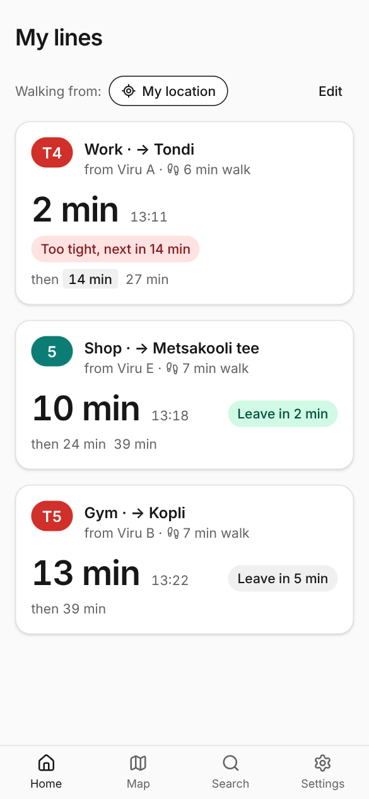
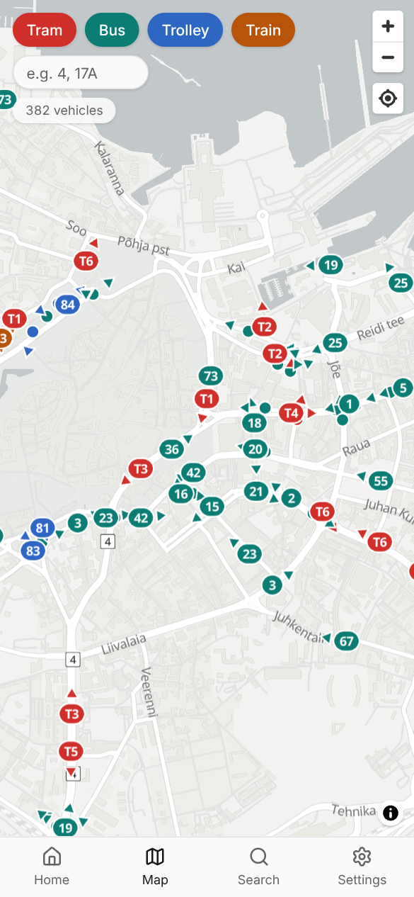
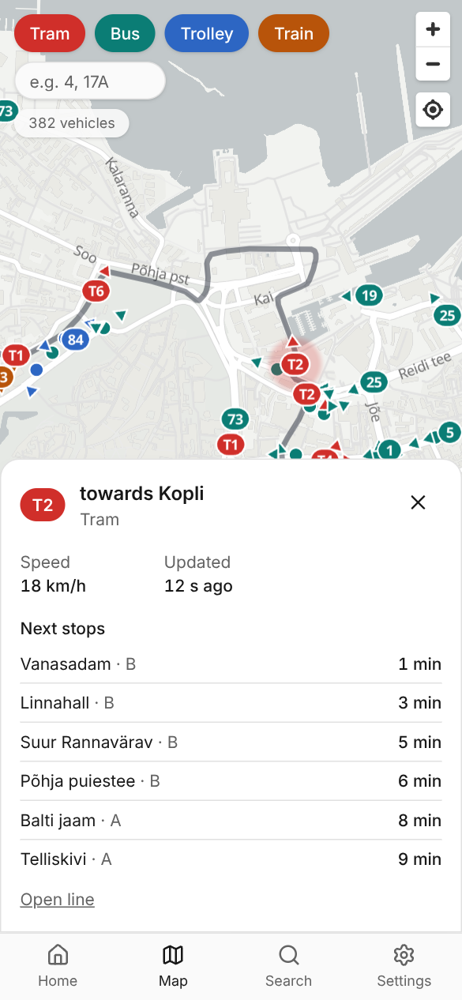
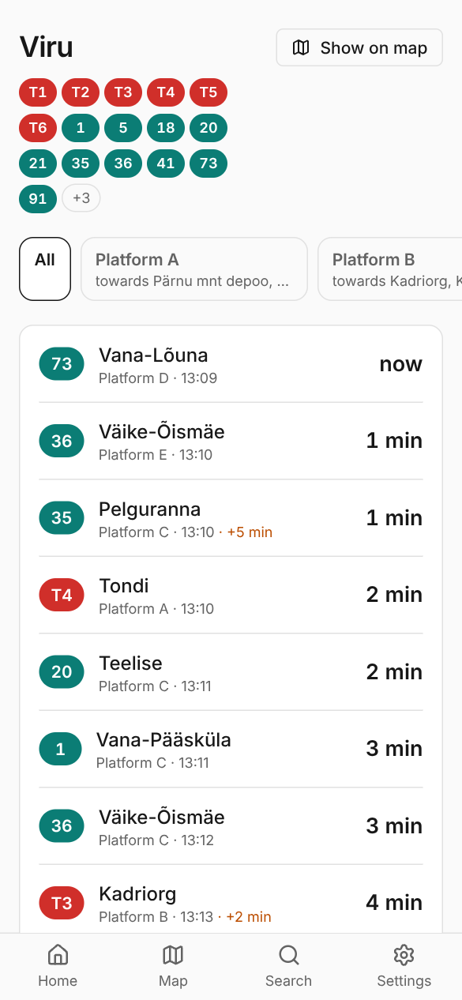
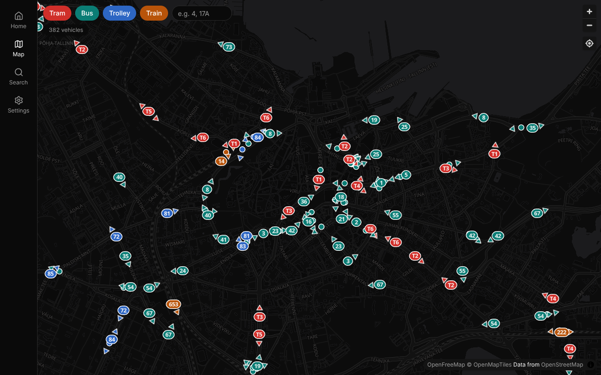
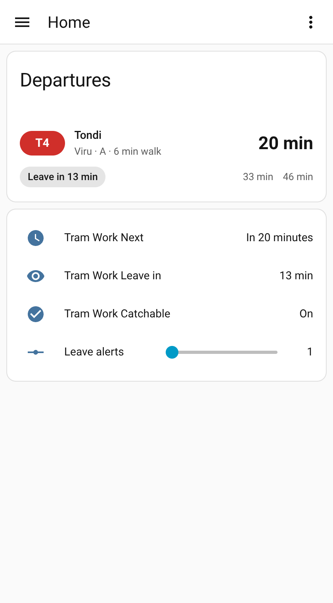

# Bus — Tallinn transit tracker

Self-hosted, multi-user app showing live Tallinn buses, trams, trolleybuses and Elron trains,
telling you whether you can make your next departure, with a Home Assistant integration.
Runs as one small container on a Raspberry Pi 5 (arm64) or amd64.

- **My lines** — save your everyday lines and see live countdowns with a *can I make it?* verdict based on real
  walking time from where you are (or a saved place).
  Or save a **trip** between two stops: every line that rides directly between them counts, whichever comes first.
  When no line goes all the way (or a change is quicker), pick one of the suggested **ways with a change** (one or
  two changes, at one stop or a short walk apart) or choose the change stop yourself; the card shows the connection
  you can catch at each change and when you arrive.
  Lines and trips can have a usual starting point for when your location is off.
- **Live map** — every bus, tram, trolleybus and Elron train, gliding along its route, with the next stops and ETAs.
- **Search, stops and lines** — departure boards per platform (live SIRI times, timetable fallback), route maps.
- **Harju county buses** — the ~220 county lines (SEBE, GoBus, Hansabuss…) from the national timetable: search,
  stop boards, line pages and My lines. Timetable only: county buses publish no live positions.
- **Accounts** — invites, admin area with feed health, audit log, settings, backups and API tokens.
- **Home Assistant** — sensors per saved line and a Lovelace card ([ha/README.md](ha/README.md)).
- **Installable** as a PWA; English and Estonian; light and dark; Prometheus metrics.

| My lines | Live map | Vehicle | Stop |
| --- | --- | --- | --- |
|  |  |  |  |



See [docs/PLAN.md](docs/PLAN.md) for the original plan, [docs/feeds.md](docs/feeds.md) for the upstream data formats and
[CHANGELOG.md](CHANGELOG.md) for what changed.

## Run

Bus ships as a multi-arch image (`linux/amd64` and `linux/arm64`), so the same tag runs on a Raspberry Pi 5 and an
x86 server. Nothing needs to be built.

```sh
mkdir bus && cd bus
curl -fsSLO https://raw.githubusercontent.com/unmaykr-a/transit-tracker/main/compose.yaml
docker compose up -d          # http://localhost:8095
```

Optional settings go in a `.env` next to it ([.env.example](.env.example)). To upgrade:

```sh
docker compose pull && docker compose up -d
```

`latest` follows releases; pin a version (`ghcr.io/unmaykr-a/bus:1.1`) to upgrade on your own schedule. The first start
after an upgrade migrates the database and re-imports the timetable data by itself.

**Homelab deployment** (bind-mounted data under `/opt/bus`, behind a reverse proxy): copy
[deploy/docker-compose.yml](deploy/docker-compose.yml) and [deploy/.env.example](deploy/.env.example) (as `.env`) to
`/opt/bus/` and follow the comments at the top of the compose file. Behind Nginx Proxy Manager, enable **WebSockets
support** for the proxy host (needed for `/ws`; the app falls back to Server-Sent Events if WebSockets are blocked)
and set `BUS_TRUSTED_PROXIES` to the proxy's network.

**Backups:** everything lives in one SQLite file, `bus.db`, in the data volume. Download a consistent copy any time
from **Administration → About → Download backup**.

## First start

Open the app and create the administrator account, or set `BUS_ADMIN_USER` and `BUS_ADMIN_PASSWORD` to create it
on first start. Invite others from **Settings → Administration → Invites**. Sign-up is invite-only by default; the
map, search and stop pages are public unless you turn **Public map** off.

## Single sign-on

Bus can sign users in with any OpenID Connect provider; it is tested with Authentik. Create an OAuth2/OpenID
provider and application in Authentik (confidential client, scopes `openid profile email` plus a `groups` claim),
set the redirect URI to `https://bus.example.com/api/v1/auth/oidc/callback`, then set `BUS_BASE_URL`,
`BUS_OIDC_ISSUER` (the application's issuer URL), `BUS_OIDC_CLIENT_ID` and `BUS_OIDC_CLIENT_SECRET`. The login page
then shows *Sign in with …* next to the password form. Accounts are created on first sign-in (turn that off with
`BUS_OIDC_AUTO_CREATE=false`); with `BUS_OIDC_ADMIN_GROUP` the admin role follows group membership on every sign-in.
Single sign-on users can add a local password under **Settings → Account**.

**Linking an existing account** (including the admin you created at setup): log in with your password, open
**Settings → Single sign-on** and press **Link … account**. After the provider confirms, either way of signing in opens
the same account; you can unlink there too (not your only way in, though). If `BUS_OIDC_ADMIN_GROUP` is set, put the
provider account in that group before signing in with it, or it becomes a regular user (the last admin is never
demoted); Bus warns you about this when you link.

## Home Assistant

Create an API token under **Settings → API tokens**, add this repository to HACS as a custom *Integration*
repository (or unpack `bus.zip` from the release) and follow [ha/README.md](ha/README.md). The dashboard card comes
with the integration. Each saved line becomes a device with `sensor.bus_<label>_next`,
`sensor.bus_<label>_leave_in` and `binary_sensor.bus_<label>_catchable`.



## Monitoring

`GET /metrics` serves Prometheus metrics: vehicles by mode (and how many are matched to routes), feed polls, errors,
latency and staleness, HTTP requests and latency by route, live map clients, users, Go memory. By default only
clients on loopback or private networks may scrape it (resolved through `BUS_TRUSTED_PROXIES`, so visitors coming
through your reverse proxy are refused). Import [deploy/grafana-dashboard.json](deploy/grafana-dashboard.json) into
Grafana for a ready-made dashboard.

```yaml
# prometheus.yml
scrape_configs:
  - job_name: bus
    static_configs:
      - targets: ["pi.lan:8095"]
```

## Configuration

| Variable | Default | Purpose |
| --- | --- | --- |
| `BUS_ADDR` | `:8080` | Listen address |
| `BUS_DATA_DIR` | `./data` | Database and caches |
| `BUS_BASE_URL` | — | Public URL, also used as the contact in the upstream User-Agent. When it is `https://`, requests for its host get Secure cookies and HSTS even if the proxy is not in `BUS_TRUSTED_PROXIES` |
| `BUS_LOG_LEVEL` | `info` | `debug`, `info`, `warn`, `error` |
| `BUS_ADMIN_USER`, `BUS_ADMIN_PASSWORD` | — | Create the first admin on an empty database |
| `BUS_TRUSTED_PROXIES` | — | CIDRs whose `X-Forwarded-For`/`-Proto` are trusted (your reverse proxy) |
| `BUS_METRICS` | `private` | `/metrics` access: `private` (loopback/private networks), `public` or `off` |
| `BUS_METRICS_TOKEN` | — | If set, `/metrics` requires `Authorization: Bearer <token>` instead |
| `BUS_OIDC_ISSUER`, `BUS_OIDC_CLIENT_ID`, `BUS_OIDC_CLIENT_SECRET` | — | Single sign-on (see above) |
| `BUS_OIDC_ADMIN_GROUP` | — | Members of this group are admins (others are demoted) |
| `BUS_OIDC_NAME`, `BUS_OIDC_AUTO_CREATE` | `single sign-on`, `true` | Button label; create accounts on first sign-in |
| `BUS_COUNTY` | `true` | Harju county buses too (timetables, and live positions and times) |
| `BUS_COUNTY_VEHICLES_URL`, `BUS_COUNTY_TRIPS_URL` | ÜTK Põhja GTFS-RT | Live county buses; `off` disables |
| `BUS_TARTU` | `true` | Tartu city buses too (timetables and live positions) |
| `BUS_TARTU_LIVE_URL` | Ridango realtime WebSocket | Live Tartu buses; `off` disables |
| `BUS_FAKE_FEEDS` | `false` | Replay recorded feeds instead of polling upstream |
| `BUS_CONTACT` | base URL or repo URL | Contact URL sent to upstream feeds |
| `BUS_GPS_URL`, `BUS_GPS_INTERVAL` | Tallinn `gps.txt`, `5s` | City vehicle feed (minimum 2 s) |
| `BUS_ELRON_URL`, `BUS_ELRON_INTERVAL` | Elron `map_data.json`, `10s` | Train feed (minimum 5 s) |
| `BUS_SIRI_URL`, `BUS_OTP_URL` | transport.tallinn.ee, api.peatus.ee | Live departures and timetables |
| `BUS_STOPS_URL`, `BUS_ELRON_GTFS_URL` | transport.tallinn.ee, eu-gtfs.remix.com | Static data (imported nightly at 03:30) |

Feed URLs, poll intervals and the User-Agent contact can also be changed at runtime in the admin settings; those
override the environment. The SQLite database lives in `BUS_DATA_DIR` (`/data` in the container). With a bind mount,
make the host directory writable by the container user.

## Security

- Passwords are hashed with argon2id; sessions are random tokens of which only a hash is stored, in `HttpOnly`,
  `SameSite=Lax` cookies (`Secure` behind HTTPS). Logins are rate limited per IP and per user name.
- Every state-changing request needs a same-origin `Origin` and the session's CSRF token. API tokens are read-only
  and never admin.
- Responses carry a strict Content Security Policy (scripts from this server only, no framing), `nosniff`,
  `Referrer-Policy` and, behind HTTPS, HSTS. Client IPs and HTTPS are only taken from `X-Forwarded-*` when the request
  comes from `BUS_TRUSTED_PROXIES`.
- Your location is never stored; it is sent with each dashboard request only. Address search goes through the server
  (In-ADS, the Land Board's public gazetteer) and is available to signed-in users only.
- Dependencies are checked with `govulncheck` and `npm audit`; the Go toolchain is pinned to a patched release.
- Run it behind a TLS-terminating reverse proxy (see `deploy/`), keep `/metrics` private (the default), and keep the
  data directory (it holds the SQLite database) out of reach of other users.

## Develop

Requires Go 1.27+ and Node 22+ (or just Docker: `docker compose -f compose.dev.yaml up --build` builds the image from
the checkout).

```sh
make web build && ./bin/bus   # http://localhost:8080
BUS_FAKE_FEEDS=1 ./bin/bus    # replay recorded feeds (offline, or at night)
make test lint
cd web && npm run e2e          # Playwright end-to-end tests (incl. axe accessibility checks)
cd ha && python -m pytest      # Home Assistant integration
cd ha/card && npm test         # Lovelace card
```

See [CLAUDE.md](CLAUDE.md) for layout and conventions.

## Data and license

Live and timetable data come from Tallinn Transport (`transport.tallinn.ee`), Elron (`elron.ee`, Elron GTFS) and
the national journey planner (`peatus.ee`); walking routes from peatus.ee and Transitous; the map from
OpenFreeMap and © OpenStreetMap contributors. Bus is not affiliated with any of them.

Bus is released under the [MIT License](LICENSE).
